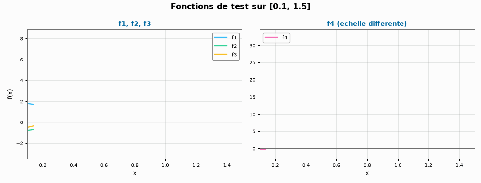
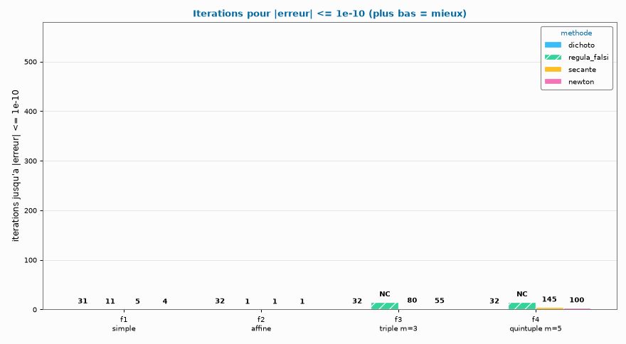
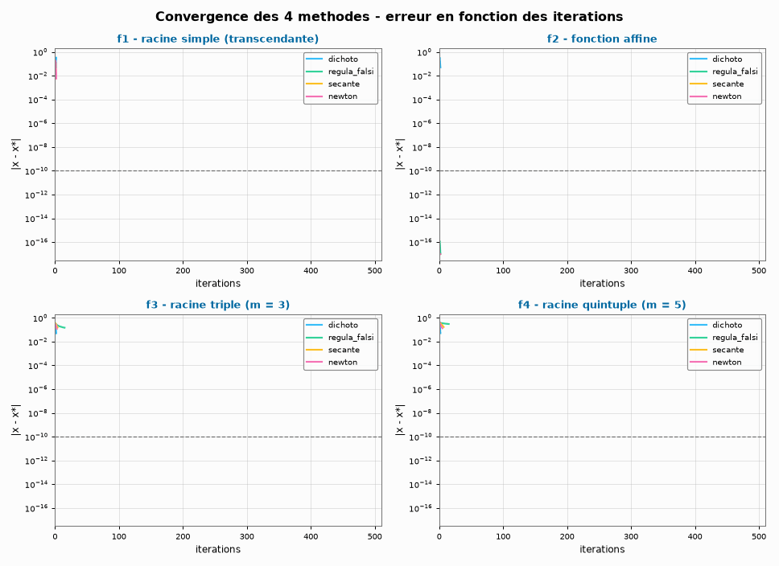

<div align="center">

  

  <picture>
    <source media="(prefers-color-scheme: dark)" srcset="https://readme-typing-svg.demolab.com/?lines=4+m%C3%A9thodes+de+r%C3%A9solution+%E2%9A%A1;Benchmark+de+vitesse+%F0%9F%8F%81;Marches+al%C3%A9atoires+Monte-Carlo+%F0%9F%8E%B2&font=Fira%20Code&center=true&vCenter=true&width=660&height=45&duration=2600&pause=800&size=22&color=A5B4FC">
    
  </picture>

  <br/>

  [](https://www.python.org/)
  [](https://numpy.org/)
  [](https://matplotlib.org/)
  [](#-pr%C3%A9sentation)

  <br/>

  [English](README.md) · 🇫🇷 **Français**

</div>

---

## 📖 Présentation


Ce dépôt rassemble des projets pédagogiques (*Travaux Pratiques* / *Travaux Dirigés*) écrits en Python, couvrant les deux piliers classiques de l'analyse numérique :

| | Projet | Thématique |
|:-:|---|---|
| 🎲 | [`TP1.py`](TP1.py) | **Simulation stochastique** — marche aléatoire 1D, libre et à barrières absorbantes |
| 🔍 | [`TD2.py`](TD2.py) | **Numérique déterministe** — 4 méthodes de recherche de racines (dichotomie, fausse position, sécante, Newton) + **benchmark de vitesse** |

Chaque script est **autonome** : il définit le modèle mathématique, lance le calcul et visualise les résultats avec `matplotlib`.

## 📂 Structure du dépôt


```
Numerical-Analysis/
├── README.md / README.fr.md  # 🇬🇧🇫🇷 Documentation (bilingue)
├── assets/
│   ├── banner.svg            # ✨ Bannière animée (titre, auteur, effets lumineux)
│   ├── divider.svg           # ➖ Séparateur animé (balayage lumineux)
│   ├── title_*_fr.svg        # 🎨 11 titres de section animés (EN + FR)
│   ├── random_walk_anim.svg  # 🎲 TP1 — marche aléatoire vivante + barrières absorbantes
│   ├── methods_cards.svg     # 🔍 TD2 — les 4 méthodes qui convergent
│   ├── podium.svg            # 🏆 Podium de classement animé (barres + confettis)
│   ├── verdict.svg           # ✅ Verdict animé (texte tapé)
│   ├── terminal.svg          # 💻 Terminal animé (installation + lancement)
│   ├── footer.svg            # 👋 Pied de page animé
│   ├── functions.png/.gif    # 📉 Courbes des fonctions de test (statique + animé)
│   ├── benchmark.png/.gif    # 🏆 Comparaison des itérations (statique + animé)
│   └── convergence.png/.gif  # 📈 Courbes de convergence (statique + animé)
├── TP1.py                   # 🎲 Simulation de marche aléatoire
└── TD2.py                   # 🔍 4 méthodes de recherche de racines + benchmark + tableau de bord
```


## 🎲 TP1 — Simulation de marche aléatoire


Simule une **marche aléatoire symétrique simple** sur les entiers, en libre et avec barrières absorbantes.

### Modèle mathématique

Une particule part de l'origine et se déplace d'une unité à gauche ou à droite à chaque pas de temps discret :

$$S_0 = 0, \qquad S_n = \sum_{i=1}^{n} X_i, \qquad P(X_i = +1) = P(X_i = -1) = \tfrac{1}{2}$$

Deux régimes sont simulés :

1. **Marche libre** — `Position(N)` fait évoluer la marche pendant `N` pas et renvoie toute la trajectoire.
2. **Marche bornée** — `PositionBornee()` s'arrête lorsque la marche touche l'une des **barrières absorbantes** $\pm 30$ (ou après 10 000 pas, par sécurité).

Pour une marche juste démarrée en $0$ avec des barrières en $\pm a$, les résultats classiques de l'urne de Gambit donnent :

$$E[T] = a^2 = 900 \text{ pas}, \qquad P(\text{toucher } +a \text{ en premier}) = \tfrac12$$

l'absorption est donc rapide en pratique (quelques centaines de pas en moyenne).

### API

| Fonction | Signature | Description |
|---|---|---|
| `PileOuFace()` | `() -> int` | Un lancer de pièce juste : renvoie `+1` ou `-1` avec probabilité ½ chacun. |
| `Position(N)` | `(N: int) -> list[int]` | Trajectoire de la marche libre : `N` pas, `N + 1` positions (origine incluse). |
| `PositionBornee()` | `() -> list[int]` | Trajectoire de la marche tuée aux barrières ±30. |

### Ce que montre la figure



Les trajectoires de la marche avec les deux barrières tracées en **pointillés rouges**, à échelle égale et avec un cadrage focalisé sur les premiers pas (`x ∈ [0, 50]`, `y ∈ [-35, 35]`).


## 🔍 TD2 — Quatre méthodes de recherche de racines


Un fichier unique et « blindé » implémentant **quatre** méthodes itératives classiques pour résoudre $f(x) = 0$, un dispatcher, et un **moteur de benchmark** qui mesure quelle méthode est la plus rapide.

> **Améliorations par rapport à la version d'origine :** validation de l'encadrement (changement de signe requis), protection contre $f'(x) = 0$, détection de stagnation, arrêt anticipé sur tolérance (plus de valeurs dupliquées en fin de liste), garde-fou contre la divergence, compteurs d'évaluations et chronométrage précis.

### Fonctions de test

| ID | $f(x)$ | $f'(x)$ | Racine $x^\star$ | Caractère |
|---|---|---|---|---|
| `f1` | $3\cos x - 2\ln(x+1) - 1$ | $-3\sin x - \dfrac{2}{x+1}$ | $0{,}7736549189316632$ | Transcendante, racine simple |
| `f2` | $2x - 1$ | $2$ | $0{,}5$ | Affine — 3 méthodes convergent en **1 étape** |
| `f3` | $(2x-1)^3$ | $6(2x-1)^2$ | $0{,}5$ | **Racine triple** (m = 3) |
| `f4` | $(2x-1)^5$ | $10(2x-1)^4$ | $0{,}5$ | **Racine quintuple** (m = 5) |



### Algorithmes implémentés

**① Dichotomie** (`dichoto`) — méthode par encadrement. Réitère le demi-segment $[a_k, b_k]$ contenant un changement de signe :

$$m_k = \frac{a_k + b_k}{2}, \qquad \text{erreur} \le \frac{b-a}{2^{\,n}} \quad \text{après } n \text{ pas}$$

**② Fausse position** (`regula_falsi`) — encadrement + interpolation linéaire, sans dérivée :

$$c = \frac{a\,f(b) - b\,f(a)}{f(b) - f(a)}$$

**③ Méthode de la sécante** (`secante`) — ouvre l'encadrement en interpolant les deux itérés précédents :

$$x_{k+1} = x_k - f(x_k)\,\frac{x_k - x_{k-1}}{f(x_k) - f(x_{k-1})}$$

**④ Newton–Raphson** (`newton`) — itération par tangente, nécessite la dérivée :

$$x_{k+1} = x_k - \frac{f(x_k)}{f'(x_k)}$$

**⑤ Dispatcher** (`dispatch`) — utilise le **pattern matching structurel** de Python 3.10 (`match` / `case`) pour router un nom de méthode (ou une fonction) vers le bon solveur.



### Comparaison rapide

| Méthode | Ordre de convergence | Besoin de $f'$ | Données initiales | Encadrement préservé |
|---|:-:|:-:|---|:-:|
| `dichoto` | 1 (erreur ÷ 2 à chaque pas) | ❌ | Encadrement $[a,b]$ avec changement de signe | ✅ |
| `regula_falsi` | 1 (peut stagner) | ❌ | Encadrement $[a,b]$ avec changement de signe | ✅ |
| `secante` | ≈ 1,618 (super-linéaire) | ❌ | Deux points $x_0, x_1$ | ❌ |
| `newton` | 2 (quadratique) ✨ | ✅ | Un point $x_0$ | ❌ |

> ⚠️ **Racines multiples : tout change !** Quand la racine est d'ordre $m > 1$, l'ordre quadratique de Newton s'effondre en un taux linéaire $\frac{m-1}{m}$ — et les méthodes par encadrement deviennent compétitives. Le benchmark ci-dessous le prouve.


## 🏆 Benchmark — quelle méthode est la plus rapide ?


`TD2.py` exécute **4 méthodes × 4 fonctions** et mesure, jusqu'à la précision $|x - x^\star| \le 10^{-10}$ :

| Métrique | Définition |
|---|---|
| **Itérations** ⭐ | itérations nécessaires pour atteindre la cible — *métrique principale* |
| **Évaluations de f** | appels à $f$ (et $f'$) jusqu'à ce point |
| **Temps** | meilleur de 200 exécutions avec `time.perf_counter()` |

### Résultats — itérations jusqu'à 1e-10

| Fonction | `dichoto` | `regula_falsi` | `secante` | `newton` | 🏆 Vainqueur |
|---|:-:|:-:|:-:|:-:|---|
| **f1** — racine simple | 31 | 11 | 5 | **4** | **newton** |
| **f2** — affine | 32 | **1** | **1** | **1** | égalité (3 méthodes) |
| **f3** — racine triple | **32** | ✗ NC (stagne) | 80 | 55 | **dichoto** |
| **f4** — racine quintuple | **32** | ✗ NC (stagne) | 145 | 100 | **dichoto** |
| **Moyenne** | **31.75** 🥇 | 253.00 | 57.75 | 40.00 🥈 | |

### Classement général

| Rang | Méthode | Itérations moy. | Évals f moy. | Temps moyen* | Victoires |
|:-:|---|:-:|:-:|:-:|:-:|
| 🥇 1 | **`dichoto`** | **31,75** | **33,75** | ~38 µs | 2 |
| 🥈 2 | `newton` | 40,00 | 40,00 | ~137 µs | 1 |
| 🥉 3 | `secante` | 57,75 | 59,75 | ~169 µs | 0 |
| 4 | `regula_falsi` | 253,00 | 255,00 | ~315 µs | 1 |

*\* le temps mural est indicatif à l'échelle des microsecondes.*



> ### ✅ Verdict
> **Champion toutes fonctions confondues : `dichoto` — 31,75 itérations en moyenne**, car la dichotomie est *immunisée contre la multiplicité des racines* : elle divise l'intervalle quoi qu'il arrive à la forme de $f$.
> - **Sur les racines simples, `newton` domine : seulement 4 itérations** (convergence quadratique) — le plus rapide quand $f'$ est disponible.
> - **Sur les racines multiples (m = 3, 5), Newton ralentit** (taux ×⅔, ×⅘) et se fait battre par la dichotomie.
> - **`regula_falsi` stagne sur f3/f4** (un bout reste bloqué) : il ne converge pas en 500 pas — **NC**.
>
> *Pas de méthode universellement meilleure : **Newton pour les racines simples avec dérivée, dichotomie quand la convergence doit être garantie.***







## 🚀 Prise en main


### Prérequis

- **Python ≥ 3.10** (pattern matching structurel utilisé dans `TD2.py`)
- **NumPy** — maths vectorielles
- **Matplotlib** — tracés
- **Tkinter** — fenêtre du tableau de bord (inclus avec les installateurs de python.org ; sur Debian/Ubuntu : `sudo apt install python3-tk`)
- **Pillow** — export des GIF animés (installé automatiquement avec Matplotlib)

### Installation


```bash
git clone https://github.com/PascalTapindjie/Numerical-Analysis.git
cd Numerical-Analysis
pip install numpy matplotlib
```

### Utilisation

```bash
python TP1.py            # 🎲 trajectoires de marche aléatoire
python TD2.py            # 🔍 benchmark + tableau de bord (4 diagrammes, écran divisé en 4) + PNG/GIF
python TD2.py --no-plot  # benchmark + graphiques, sans fenêtre GUI
```

> 💡 **Tableau de bord interactif :** lancer `python TD2.py` ouvre une **fenêtre Tkinter** présentant les quatre diagrammes du benchmark — **① fonctions de test · ② convergence · ③ itérations par fonction · ④ classement général** — sur un **écran divisé en quatre (2×2)**, avec le vainqueur annoncé dans l'en-tête. Les graphiques PNG et GIF animés sont toujours écrits dans `assets/`.


## 📊 Exemple de sortie


```
====================================================================================
 BENCHMARK - 4 methodes x 4 fonctions   (objectif : |x - x*| <= 1e-10)
====================================================================================

f1 : 3cos(x) - 2ln(x+1) - 1   [racine simple (transcendante)]
  methode          iters  evals f  evals fp  temps (us)   erreur fin.  remarque
  newton               4        4         4       25.40      0.00e+00  <-- PLUS RAPIDE
  secante              5        7         0       29.50      0.00e+00
  regula_falsi        11       13         0       42.90      0.00e+00
  dichoto             31       33         0       68.30      0.00e+00
...
 CLASSEMENT GENERAL (moyenne sur les 4 fonctions)
  1     dichoto               31.75         33.75          38.425          2
  2     newton                40.00         40.00         136.575          1
  3     secante               57.75         59.75         169.200          0
  4     regula_falsi         253.00        255.00         314.900          1

  VERDICT : la methode la plus rapide est  << dichoto >>
```

Trois graphiques statiques et leurs **versions GIF animées** sont ensuite enregistrés dans `assets/` : `functions.png` / `functions_anim.gif`, `convergence.png` / `convergence_anim.gif`, `benchmark.png` / `benchmark_anim.gif` — les GIF bouclent en boucle infinie et sont ceux que vous voyez intégrés ci-dessus.


## 🗺️ Feuille de route & limites connues


- [x] **Blinder `TD2.py`** — validation du changement de signe, garde $f'(x)=0$, détection de stagnation, arrêt sur tolérance.
- [x] **Ajouter une 4ᵉ méthode** (`regula_falsi`) et un **moteur de benchmark** qui prouve quelle méthode est la plus rapide.
- [x] **Tableau de bord interactif** — `python TD2.py` ouvre les 4 diagrammes dans une fenêtre Tkinter 2×2 (écran divisé en quatre).
- [x] **Graphiques animés dans le README** — versions GIF de chaque graphe (courbes tracées progressivement, barres qui poussent).
- [x] **README entièrement animé** — 30+ animations SVG SMIL : titres de section, séparateurs lumineux, marche aléatoire vivante, cartes de méthodes, podium avec confettis, verdict tapé, terminal animé, pied de page.
- [ ] **Hygiène des figures dans `TP1.py`** — séparer marche libre et marche bornée sur deux figures, et appeler `plt.show()`.
- [ ] **Paramétrage** — exposer nombres de pas, barrières et intervalles en constantes ou arguments CLI.
- [ ] **`requirements.txt`** pour une installation en une ligne.
- [ ] **Tests automatisés** (`pytest`).


## 🤝 Contribuer


Les contributions, suggestions et signalements de bugs sont les bienvenus !

1. 🍴 Forkez le dépôt
2. 🌿 Créez votre branche (`git checkout -b feature/amazing-improvement`)
3. ✅ Committez vos changements (`git commit -m 'Add amazing improvement'`)
4. 🚀 Poussez sur la branche (`git push origin feature/amazing-improvement`)
5. 🔀 Ouvrez une **Pull Request**


## ✍️ Auteur


**Pascal Tapindjie** — [@PascalTapindjie](https://github.com/PascalTapindjie)

## 📜 Licence


Ce dépôt ne déclare pas encore de licence. Si vous souhaitez réutiliser le code, merci d'ouvrir une issue.


