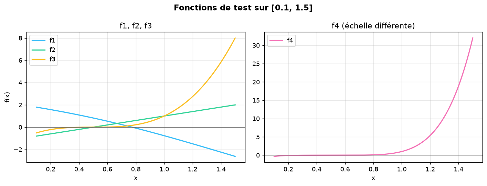
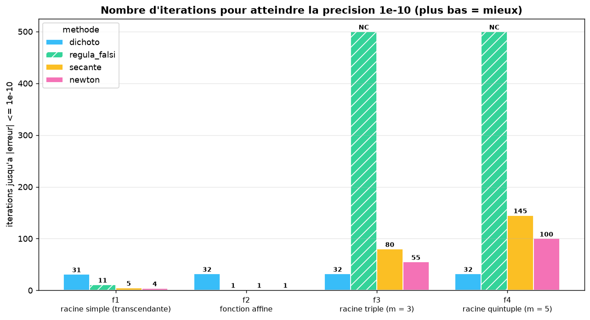
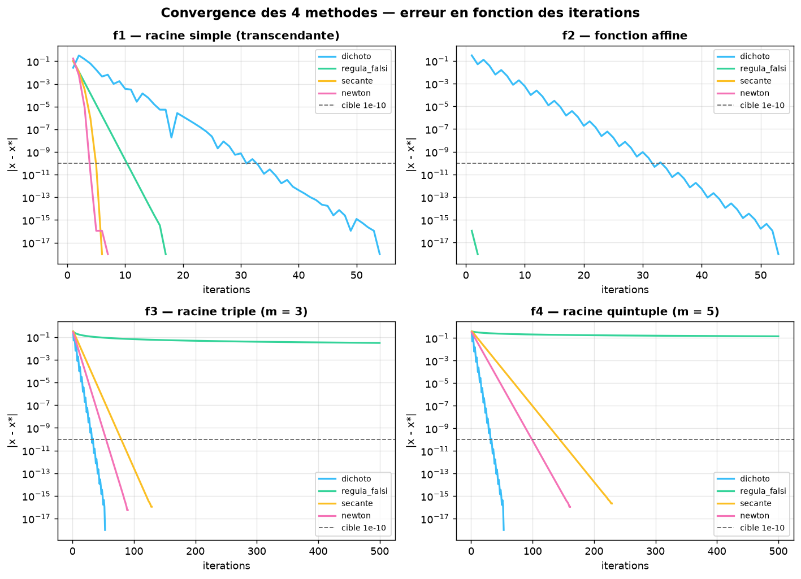

<div align="center">

  

  <picture>
    <source media="(prefers-color-scheme: dark)" srcset="https://readme-typing-svg.demolab.com/?lines=4+root-finding+methods+%E2%9A%A1;Speed+benchmark+%F0%9F%8F%81;Monte-Carlo+random+walks+%F0%9F%8E%B2&font=Fira%20Code&center=true&vCenter=true&width=640&height=45&duration=2600&pause=800&size=22&color=A5B4FC">
    
  </picture>

  <br/>

  [](https://www.python.org/)
  [](https://numpy.org/)
  [](https://matplotlib.org/)
  [](#-overview)

  <br/>

  🌐 **English** · [Français](README.fr.md)

</div>

---

## 📖 Overview

This repository collects educational projects (*Travaux Pratiques* / *Travaux Dirigés*) written in Python, covering the two classical pillars of numerical analysis:

| | Project | Topic |
|:-:|---|---|
| 🎲 | [`TP1.py`](TP1.py) | **Stochastic simulation** — 1D random walk, free and with absorbing barriers |
| 🔍 | [`TD2.py`](TD2.py) | **Deterministic numerics** — 4 root-finding methods (dichotomy, regula falsi, secant, Newton) + **speed benchmark** |

Each script is **self-contained**: it defines the mathematical model, runs the computation, and visualises the results with `matplotlib`.

## 📂 Repository structure

```
Numerical-Analysis/
├── README.md           # 🇬🇧 Documentation (English)
├── README.fr.md        # 🇫🇷 Documentation (Français)
├── assets/
│   ├── banner.svg      # ✨ Animated banner (title & author, light effects)
│   ├── functions.png   # 📉 Test-function curves
│   ├── benchmark.png   # 🏆 Iterations-to-target comparison
│   └── convergence.png # 📈 Convergence curves (log error)
├── TP1.py              # 🎲 Random-walk simulation
└── TD2.py              # 🔍 4 root-finding methods + benchmark
```

---

## 🎲 TP1 — Random Walk Simulation

Simulates a **simple symmetric random walk** on the integers, both freely and with absorbing barriers.

### Mathematical model

A particle starts at the origin and moves left or right by one unit at each discrete time step:

$$S_0 = 0, \qquad S_n = \sum_{i=1}^{n} X_i, \qquad P(X_i = +1) = P(X_i = -1) = \tfrac{1}{2}$$

Two regimes are simulated:

1. **Free walk** — `Position(N)` runs the walk for `N` steps and returns the whole trajectory.
2. **Bounded walk** — `PositionBornee()` stops the walk when it hits one of the **absorbing barriers** at $\pm 30$ (or after 10 000 steps as a safety cap).

For a fair walk started at $0$ with barriers at $\pm a$, classical gambler's-ruin results give:

$$E[T] = a^2 = 900 \text{ steps}, \qquad P(\text{hit } +a \text{ first}) = \tfrac12$$

so absorption happens quickly in practice (a few hundred steps on average).

### API

| Function | Signature | Description |
|---|---|---|
| `PileOuFace()` | `() -> int` | One fair coin flip: returns `+1` or `-1` with probability ½ each. |
| `Position(N)` | `(N: int) -> list[int]` | Trajectory of the free walk: `N` steps, `N + 1` positions (origin included). |
| `PositionBornee()` | `() -> list[int]` | Trajectory of the walk killed at the barriers ±30. |

### What the figure shows

The walk trajectories together with the two barrier lines drawn in **red dashed** style, with an equal aspect ratio and a viewport focused on the first steps (`x ∈ [0, 50]`, `y ∈ [-35, 35]`).

---

## 🔍 TD2 — Four Root-Finding Methods

A single hardened file implementing **four** classic iterative methods to solve $f(x) = 0$, a dispatcher, and a **benchmark engine** that measures which method is the fastest.

> **Improvements over the original version:** bracket validation (sign change required), guard against $f'(x) = 0$, stall detection, tolerance-based early stopping (no duplicated values at the end of lists), divergence guard, evaluation counters and precise timing.

### Test functions

| ID | $f(x)$ | $f'(x)$ | Root $x^\star$ | Character |
|---|---|---|---|---|
| `f1` | $3\cos x - 2\ln(x+1) - 1$ | $-3\sin x - \dfrac{2}{x+1}$ | $0.7736549189316632$ | Transcendental, simple root |
| `f2` | $2x - 1$ | $2$ | $0.5$ | Affine — 3 methods converge in **1 step** |
| `f3` | $(2x-1)^3$ | $6(2x-1)^2$ | $0.5$ | **Triple root** (m = 3) |
| `f4` | $(2x-1)^5$ | $10(2x-1)^4$ | $0.5$ | **Quintic root** (m = 5) |



### Implemented algorithms

**① Dichotomy** (`dichoto`) — bracketing method. Repeatedly halves the interval $[a_k, b_k]$ that contains a sign change:

$$m_k = \frac{a_k + b_k}{2}, \qquad \text{error} \le \frac{b-a}{2^{\,n}} \quad \text{after } n \text{ steps}$$

**② Regula falsi** (`regula_falsi`) — bracketing + linear interpolation, no derivative needed:

$$c = \frac{a\,f(b) - b\,f(a)}{f(b) - f(a)}$$

**③ Secant method** (`secante`) — opens the bracket using the two previous iterates:

$$x_{k+1} = x_k - f(x_k)\,\frac{x_k - x_{k-1}}{f(x_k) - f(x_{k-1})}$$

**④ Newton–Raphson** (`newton`) — tangent iteration, requires the derivative:

$$x_{k+1} = x_k - \frac{f(x_k)}{f'(x_k)}$$

**⑤ Dispatcher** (`dispatch`) — uses Python 3.10 **structural pattern matching** (`match` / `case`) to route a method name (or function) to the right solver.

### Quick comparison

| Method | Order of convergence | Needs $f'$ | Initial data | Bracket preserved |
|---|:-:|:-:|---|:-:|
| `dichoto` | 1 (error ÷ 2 each step) | ❌ | Bracket $[a,b]$ with sign change | ✅ |
| `regula_falsi` | 1 (can stagnate) | ❌ | Bracket $[a,b]$ with sign change | ✅ |
| `secante` | ≈ 1.618 (super-linear) | ❌ | Two points $x_0, x_1$ | ❌ |
| `newton` | 2 (quadratic) ✨ | ✅ | One point $x_0$ | ❌ |

> ⚠️ **Multiple roots change everything:** when the root has multiplicity $m > 1$, Newton's quadratic order collapses to a linear rate $\frac{m-1}{m}$ — and bracketing methods become competitive. The benchmark below proves it.

---

## 🏆 Benchmark — which method is the fastest?

`TD2.py` runs **4 methods × 4 functions** and measures, up to the precision target $|x - x^\star| \le 10^{-10}$:

| Metric | Definition |
|---|---|
| **Iterations** ⭐ | iterations needed to reach the target — *primary metric* |
| **f-evaluations** | calls to $f$ (and $f'$) up to that point |
| **Time** | best of 200 runs with `time.perf_counter()` |

### Results — iterations to reach 1e-10

| Function | `dichoto` | `regula_falsi` | `secante` | `newton` | 🏆 Winner |
|---|:-:|:-:|:-:|:-:|---|
| **f1** — simple root | 31 | 11 | 5 | **4** | **newton** |
| **f2** — affine | 32 | **1** | **1** | **1** | tie (3 methods) |
| **f3** — triple root | **32** | ✗ NC (stalls) | 80 | 55 | **dichoto** |
| **f4** — quintic root | **32** | ✗ NC (stalls) | 145 | 100 | **dichoto** |
| **Mean** | **31.75** 🥇 | 253.00 | 57.75 | 40.00 🥈 | |

### General ranking

| Rank | Method | Mean iterations | Mean f-evals | Mean time* | Wins |
|:-:|---|:-:|:-:|:-:|:-:|
| 🥇 1 | **`dichoto`** | **31.75** | **33.75** | ~38 µs | 2 |
| 🥈 2 | `newton` | 40.00 | 40.00 | ~137 µs | 1 |
| 🥉 3 | `secante` | 57.75 | 59.75 | ~169 µs | 0 |
| 4 | `regula_falsi` | 253.00 | 255.00 | ~315 µs | 1 |

*\* wall-time is indicative at microsecond scale.*

> ### ✅ Verdict
> **Overall champion: `dichoto` — 31.75 iterations on average**, because dichotomy is *immune to root multiplicity*: it halves the interval no matter the shape of $f$.
> - **On simple roots, `newton` wins big: only 4 iterations** (quadratic convergence) — the fastest when $f'$ is available.
> - **On multiple roots (m = 3, 5), Newton slows down** to linear rates (×⅔, ×⅘) and gets beaten by dichotomy.
> - **`regula_falsi` stagnates on f3/f4** (one endpoint stays stuck) — it does not converge within 500 steps: **NC**.
>
> *No universally best method: **Newton for simple roots with a derivative, dichotomy when convergence must be guaranteed.***





---

## 🚀 Getting started

### Requirements

- **Python ≥ 3.10** (uses structural pattern matching in `TD2.py`)
- **NumPy** — vectorised maths
- **Matplotlib** — plotting

### Installation

```bash
git clone https://github.com/PascalTapindjie/Numerical-Analysis.git
cd Numerical-Analysis
pip install numpy matplotlib
```

### Usage

```bash
python TP1.py         # 🎲 random-walk trajectories
python TD2.py         # 🔍 benchmark: tables, verdict + 3 charts
python TD2.py --no-plot   # benchmark without opening chart windows
```

> 💡 **Tip:** interactive environments (Spyder, PyCharm, Jupyter) display the figures automatically. From a plain terminal, `plt.show()` opens the chart windows at the end of the run.

---

## 📊 Example output

```
====================================================================================
 BENCHMARK - 4 methodes x 4 fonctions   (objectif : |x - x*| <= 1e-10)
====================================================================================

f1 : 3cos(x) - 2ln(x+1) - 1   [racine simple (transcendante)]
  methode          iters  evals f  evals fp  temps (us)   erreur fin.  remarque
  newton               4        4         4       25.40      0.00e+00  <-- PLUS RAPIDE
  secante              5        7         0       29.50      0.00e+00
  regula_falsi        11       13         0       42.90      0.00e+00
  dichoto             31       33         0       68.30      0.00e+00
...
 CLASSEMENT GENERAL (moyenne sur les 4 fonctions)
  1     dichoto               31.75         33.75          38.425          2
  2     newton                40.00         40.00         136.575          1
  3     secante               57.75         59.75         169.200          0
  4     regula_falsi         253.00        255.00         314.900          1

  VERDICT : la methode la plus rapide est  << dichoto >>
```

Three charts are then written to `assets/`: `functions.png`, `convergence.png`, `benchmark.png`.

---

## 🗺️ Roadmap & known limitations

- [x] **Harden `TD2.py`** — sign-change validation, $f'(x)=0$ guard, stall detection, tolerance-based early stop.
- [x] **Add a 4th method** (`regula_falsi`) and a **benchmark engine** proving which method is fastest.
- [ ] **`TP1.py` figure hygiene** — split the free walk and the bounded walk onto separate figures, and call `plt.show()`.
- [ ] **Parameterisation** — expose step counts, barriers and intervals as constants or CLI arguments.
- [ ] **`requirements.txt`** for one-line environment setup.
- [ ] **Automated tests** (`pytest`).

---

## 🤝 Contributing

Contributions, suggestions and bug reports are welcome!

1. 🍴 Fork the repository
2. 🌿 Create your feature branch (`git checkout -b feature/amazing-improvement`)
3. ✅ Commit your changes (`git commit -m 'Add amazing improvement'`)
4. 🚀 Push to the branch (`git push origin feature/amazing-improvement`)
5. 🔀 Open a **Pull Request**

## ✍️ Author

**Pascal Tapindjie** — [@PascalTapindjie](https://github.com/PascalTapindjie)

## 📜 License

This repository does not currently declare a license. If you wish to reuse the code, please open an issue.
